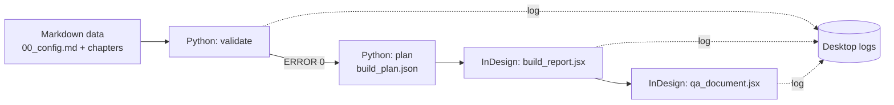

# arsr-skills

Skills and Markdown data standards that let any AI agent build an **Annual Report (AR)** or **Sustainability Report (SR)** in **Adobe InDesign**.
Skill dan standar data Markdown agar agen AI mana pun dapat membangun **Laporan Tahunan (LT)** atau **Laporan Keberlanjutan (LK)** di **Adobe InDesign**.

> **Status / Status:** the data engine, validators, skills and evals are working and tested (36 automated tests). The InDesign scripts run in real InDesign and produce a full 80-page dummy report, but are still being refined from real-run logs. / Mesin data, validator, skill, dan evals sudah berjalan dan teruji (36 tes otomatis). Skrip InDesign sudah berjalan di InDesign asli dan menghasilkan laporan dummy 80 halaman, tetapi masih disempurnakan dari log uji.

## How it works / Cara kerja



- **EN.** Python is the "brain" (parse, validate, plan). JSX (ExtendScript ES3) is the executor inside InDesign. Validators and QA are read-only and only write a log to your Desktop.
- **ID.** Python adalah "otak" (baca, validasi, rencana). JSX (ExtendScript ES3) adalah eksekutor di InDesign. Validator dan QA hanya membaca dan menulis log ke Desktop.

## Quick start (Windows 11, Python 3.8+, OpenCode) / Mulai cepat

1. Open this folder in OpenCode. Skills in `.opencode/skills/` are discovered automatically.
2. Make your own config: copy `templates/dummy-company/data/00_config.md` to e.g. `C:\work\smlg.md`, then set company name, year, theme, palette, fonts.
3. Create, check, plan:

```powershell
python engine\run.py dummy C:\work\smlg --config C:\work\smlg.md
python engine\run.py validate C:\work\smlg
python engine\run.py plan C:\work\smlg
```

4. Close all open documents in InDesign. Run `engine\jsx\build_report.jsx` **once** (File > Scripts > Scripts Panel). There is no popup; read `Desktop\ARSR_Build_Done.txt` and `Desktop\ARSR_Build_Log.txt`.
5. Open the result and run `engine\jsx\qa_document.jsx`; read `Desktop\ARSR_QA_Log.txt`.

Keep project folders **outside** the repo (for example `C:\work\...`) so client data never lands on GitHub. If you change the year or company name later, regenerate with `--force`; editing only the config leaves old year columns (validator rule NUM-04).

## Annual Report vs Sustainability Report / LT vs LK

The type is one line in `00_config.md`: `jenis: LT` (annual), `LK` (sustainability) or `LT+LK` (integrated). The validator rejects any other value. The dummy generator currently creates the integrated structure (7 chapters); for LT-only or LK-only, adjust the `## HAL` blocks and let `validate` check the result. Separate LT and LK templates are planned.

Example prompts:

```text
Use skill arsr-start. New project type LT (annual report). Focus on profile, governance and financials. Skip GRI material-topic pages.
Use skill arsr-start. New project type LK (sustainability report). Focus on strategy, economic, environment, social and the GRI index.
```

## Prompts that save tokens / Prompt hemat token

Name the task, the skill and the limits. Let the model read only what it needs.

```text
Use skill arsr-start. New project C:\work\smlg from config C:\work\smlg.md. Run validate, plan, then build ONCE. Report only the first ERROR and the final result.
Use skill arsr-validate-qa. Fix the first ERROR in the validation log, rerun, repeat until 0 ERROR. Do not read chapter files the log does not mention.
Use skill indesign-jsx-basics. First ERROR from the build log: <paste>. Change one place only, run lint and tests.
Change only data/00_config.md: Primary #0B3C5D, font Inter. Do not touch the engine.
```

Add: `Answer in at most 5 lines. Do not paste script contents into chat.` Tips: one goal per session; paste only the first ERROR line of a log; never ask a model to read all of `catalogs/`.

## Source files from copywriters (DOCX, Excel, PDF) / Berkas dari copywriter

**Today:** the repo reads only Markdown in a project `data/` folder. It does not import DOCX, XLSX or PDF automatically. Put source files **outside the repo**, for example `C:\work\smlg\sumber\`, and ask the agent to convert them chapter by chapter into `data/NN_*.md` following `arsr-data-spec` (Excel tables become pipe tables, DOCX text becomes `isi.id` / `isi.en`). Then run `validate`; mismatched numbers are caught there. Mark anything unverified `dummy: ya` until checked.

**Planned:** a skill `arsr-import-sources` plus `tools/import_*.py` that draft the Markdown from DOCX, XLSX and PDF.

## Layout library / Pustaka layout (planned)

Layouts (cover, back cover, one- and two-page dividers, master page with chapter navigation and folio) are currently code in `engine/jsx/build_report.jsx`. AI agents cannot learn from `.indd` files. Planned approach:

- Export each reference layout to PNG/PDF into `layouts/<name>/` (for example `layouts/cover/`, `layouts/divider-1-page/`, `layouts/divider-2-page/`, `layouts/master/`).
- Add one Markdown spec per folder: block sizes, margins, nav and folio positions, swatch and style names.
- A skill `arsr-layout-library` makes the agent read image + spec, then edit the matching template function. New page types become new `tipe:` values.

Standard layouts go in the repo; client-specific layouts stay outside it.

## What is in the repo / Isi repo

| Path | Purpose |
|---|---|
| `AGENTS.md` | Rules every agent must follow |
| `.opencode/skills/` | `arsr-start` (router), `arsr-data-spec`, `arsr-style-system`, `arsr-validate-qa`, `arsr-build-test`, `indesign-jsx-basics` |
| `catalogs/` | GRI / OJK / SEOJK numbering, version rules, regulation profiles. Rows marked `verified: no` must be checked against the official text before printing |
| `templates/dummy-company/` | Config of a fictional company (chapters are generated) |
| `engine/` | Python parser, validator, dummy generator, planner (`run.py`); `engine/jsx/` build and QA scripts |
| `tools/` | `jsx_lint.py` (ES3 linter), `eval_check.py` (eval helper) |
| `tests/` | 36 tests, including a Node mock of the InDesign DOM |
| `evals/` | Tasks E1-E6 to test skills on free OpenCode models |

## Checks and logs / Pemeriksaan dan log

| Step | Command | Log on Desktop |
|---|---|---|
| Data | `python engine\run.py validate <project>` | `ARSR_Validate_Log.txt` |
| Plan | `python engine\run.py plan <project>` | same log (rule PLN-01: index/TOC does not fit) |
| Build | `build_report.jsx` in InDesign | `ARSR_Build_Done.txt`, `ARSR_Build_Log.txt`, `Dummy_Register.txt` |
| Document | `qa_document.jsx` | `ARSR_QA_Log.txt` (DOC-01..08) |
| Code | `python tools\jsx_lint.py engine\jsx` | console |
| Tests | `python -m unittest discover -s tests` | console (Node.js optional for the mock build test) |

Rule ids are listed in `.opencode/skills/arsr-data-spec/references/validation-rules.md`.

## Testing skills on free models / Menguji skill

See `evals/README.md`: six tasks (new project, fix data, fix script, regulation numbering, design via config, build error) with automatic graders where possible (`python tools\eval_check.py`).

## Known limits / Batasan

- Index and TOC pages are packed by estimated row height; real InDesign can still differ, so read the build log.
- Table pages leave empty space below short tables; placeholder fill is not implemented yet.
- GRI Topic Standard titles are `verified: no`; OJK/SEOJK data came from a partial third-party copy; GRI 101/102/103 disclosure numbers are missing, so `gri.versi: 2027` is not fully usable.
- The Annual Report structure beyond the dummy (financial statement layouts) is not covered.

## Scope notes / Catatan

- No real company data is included. All sample content is fictional and flagged `dummy: ya`.
- Regulation catalogs aid validation; they are not legal advice. / Katalog regulasi membantu validasi dan bukan nasihat hukum.
- License: see `LICENSE`.
