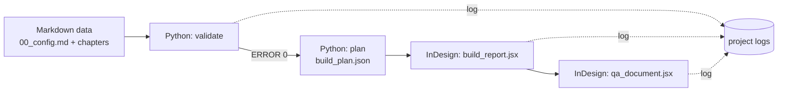

# arsr-skills

Skills and Markdown data standards that let any AI agent build an **Annual Report (AR)** or **Sustainability Report (SR)** in **Adobe InDesign**.
Skill dan standar data Markdown agar agen AI mana pun dapat membangun **Laporan Tahunan (LT)** atau **Laporan Keberlanjutan (LK)** di **Adobe InDesign**.

> **Status / Status:** the data engine, validators, skills and evals are working and tested (51 automated tests). The InDesign scripts run in real InDesign and produce a full 80-page dummy report, but are still being refined from real-run logs. / Mesin data, validator, skill, dan evals sudah berjalan dan teruji (51 tes otomatis). Skrip InDesign sudah berjalan di InDesign asli dan menghasilkan laporan dummy 80 halaman, tetapi masih disempurnakan dari log uji.

## How it works / Cara kerja



- **EN.** Python is the "brain" (parse, validate, plan). JSX (ExtendScript ES3) is the executor inside InDesign. Validators and QA are read-only and only write a log to `<project>\logs\`.
- **ID.** Python adalah "otak" (baca, validasi, rencana). JSX (ExtendScript ES3) adalah eksekutor di InDesign. Validator dan QA hanya membaca dan menulis log ke `<project>\logs\`.

## Quick start (Windows 11, Python 3.8+, OpenCode) / Mulai cepat

1. Open this folder in OpenCode. Skills in `.opencode/skills/` are discovered automatically.
2. Make your own config: copy `templates/dummy-company/data/00_config.md` to e.g. `C:\work\smlg.md`, then set company name, year, theme, palette, fonts.
3. Create, check, plan:

```powershell
python engine\run.py new C:\work\smlg --jenis LT+LK --divider 2 --config C:\work\smlg.md
python engine\run.py validate C:\work\smlg
python engine\run.py plan C:\work\smlg
```

`new` makes `data\` (Markdown), `source\` (the copywriter's Word/Excel), `build\` and `logs\`. `--jenis` is LK, LT or LT+LK; `--divider` is 1 (one page) or 2 (two facing pages) per chapter.

4. Close all open documents in InDesign. Run `C:\work\smlg\build\run_build.jsx` **once** (File > Scripts > Scripts Panel, double-click). It is written by `plan` and points at this project. There is no popup; read `<project>\logs\ARSR_Build_Done.txt` and `<project>\logs\ARSR_Build_Log.txt`.
5. Open the result and run `<project>\build\run_qa.jsx`; read `<project>\logs\ARSR_QA_Log.txt`.

Keep project folders **outside** the repo (for example `C:\work\...`) so client data never lands on GitHub. If you change the year or company name later, regenerate with `--force`; editing only the config leaves old year columns (validator rule NUM-04).

## Annual Report vs Sustainability Report / LT vs LK

- **LT** = Laporan Tahunan (Annual Report, SEOJK 16/SEOJK.04/2021). **LK** = Laporan Keberlanjutan (Sustainability Report, POJK 51/POJK.03/2017 + GRI). **LT+LK** = integrated report with one shared profile and governance chapter.
- The type is one line in `00_config.md`: `jenis: LT`, `LK` or `LT+LK`, or `--jenis` in `run.py new`. The chapters of each type are defined in `structures/` (`lk.md`, `lt.md`, `lt-lk.md`, no company names). The validator reads that file: required chapters (STR-20), required index pages (STR-21). For LT the GRI and POJK 51 rules are skipped; for LK the SEOJK rules are skipped.
- Chapter dividers: `divider: 1` (one page) or `divider: 2` (two facing pages: a left page with number and title, a right page with the chapter intro, the list of its sections and a photo slot). With 2, `catatan` filler pages are added where needed so a divider starts on a left page and the total stays a multiple of 4.

Example prompts:

```text
Use skill arsr-start. New project type LT (annual report). Focus on profile, governance and financials. Skip GRI material-topic pages.
Use skill arsr-start. New project type LK (sustainability report). Focus on strategy, economic, environment, social and the GRI index.
```

## Prompts that save tokens / Prompt hemat token

Name the task, the skill and the limits. Let the model read only what it needs.

```text
Use skill arsr-start. New project C:\work\smlg from config C:\work\smlg.md. Run validate, plan, then build ONCE. Report only the first ERROR and the final result.
Use skill arsr-validate-qa. Fix the first ERROR in the validation log, rerun, repeat until 0 ERROR. Do not read chapter files the log does not mention.
Use skill indesign-jsx-basics. First ERROR from the build log: <paste>. Change one place only, run lint and tests.
Change only data/00_config.md: Primary #0B3C5D, font Inter. Do not touch the engine.
```

Add: `Answer in at most 5 lines. Do not paste script contents into chat.` Tips: one goal per session; paste only the first ERROR line of a log; never ask a model to read all of `catalogs/`.

## Source files from copywriters (Word, Excel) / Berkas dari copywriter

Copywriters write in **Word** with a few styles (Heading 1/2/3, Normal, English, Meta); big tables may come from **Excel**. No Markdown knowledge is needed. Guide: `docs/penulisan-word.md`; example: `templates/contoh-word/Contoh_Laporan_LT-LK.docx` (+ `Contoh_Tabel.xlsx`).

```powershell
python engine\run.py new C:\work\smlg --jenis LK --divider 2 --config C:\work\smlg.md
copy *.docx *.xlsx C:\work\smlg\source\
python engine\run.py import C:\work\smlg      # source\ -> data\*.md, old data kept in build\data_before_import
python engine\run.py validate C:\work\smlg
```

The importer uses only the Python standard library and never edits the Word or Excel files. A single Word file with text and tables is read in one pass and split into one Markdown file per chapter. Page numbers are assigned automatically (long sections continue on the next page); cover, table of contents, dividers, indexes and filler pages are generated. Read `logs\ARSR_Import_Log.txt` for what could not be carried over (images, merged cells, lists, missing chapters). **PDF is not imported** (not suited to fast agent work); ask the copywriter for the Word source.

Layouts are not part of this flow: the current layout stays as it is in `engine/jsx/build_report.jsx`; only the divider choice (1 or 2 pages) is configurable.

## What is in the repo / Isi repo

| Path | Purpose |
|---|---|
| `AGENTS.md` | Rules every agent must follow |
| `structures/` | Chapters and required pages of each report type (LK, LT, LT+LK) |
| `docs/` | `penulisan-word.md`: how copywriters write in Word |
| `templates/contoh-word/` | Example Word + Excel file for copywriters (a complete fictional LT+LK report) |
| `.opencode/skills/` | `arsr-start` (router), `arsr-import-word`, `arsr-data-spec`, `arsr-style-system`, `arsr-validate-qa`, `arsr-build-test`, `indesign-jsx-basics` |
| `catalogs/` | GRI / OJK / SEOJK numbering, version rules, regulation profiles. Rows marked `verified: no` must be checked against the official text before printing |
| `templates/dummy-company/` | Config of a fictional company (chapters are generated) |
| `engine/` | Python parser, validator, dummy generator, planner (`run.py`); `engine/jsx/` build and QA scripts |
| `tools/` | `jsx_lint.py` (ES3 linter), `eval_check.py` (eval helper), `make_word_example.py` (builds the example Word file) |
| `tests/` | 51 tests, including a Node mock of the InDesign DOM |
| `evals/` | Tasks E1-E6 to test skills on free OpenCode models |

## Checks and logs / Pemeriksaan dan log

| Step | Command | Log in `<project>/logs/` |
|---|---|---|
| Data | `python engine\run.py validate <project>` | `ARSR_Validate_Log.txt` |
| Plan | `python engine\run.py plan <project>` | same log (rule PLN-01: index/TOC does not fit) |
| Build | `build_report.jsx` in InDesign | `ARSR_Build_Done.txt`, `ARSR_Build_Log.txt`, `Dummy_Register.txt` |
| Document | `qa_document.jsx` | `ARSR_QA_Log.txt` (DOC-01..08) |
| Code | `python tools\jsx_lint.py engine\jsx` | console |
| Tests | `python -m unittest discover -s tests` | console (Node.js optional for the mock build test) |

Rule ids are listed in `.opencode/skills/arsr-data-spec/references/validation-rules.md`.

## Testing skills on free models / Menguji skill

See `evals/README.md`: six tasks (new project, fix data, fix script, regulation numbering, design via config, build error) with automatic graders where possible (`python tools\eval_check.py`).

## Known limits / Batasan

- Index and TOC pages are packed by estimated row height; real InDesign can still differ, so read the build log.
- Short tables and quote pages are filled with a tint placeholder box (photo or chart slot); the table height is read from InDesign at build time.
- Imported page splitting uses character and row budgets (`TEXT_BUDGET`, `INTRO_BUDGET`, `TABLE_ROWS` in `engine/arsr/importer.py`), so check the first real build for overflow warnings.
- GRI Topic Standard titles are `verified: no`; OJK/SEOJK data came from a partial third-party copy; GRI 101/102/103 disclosure numbers are missing, so `gri.versi: 2027` is not fully usable.
- The Annual Report structure beyond the dummy (financial statement layouts) is not covered.

## Scope notes / Catatan

- No real company data is included. All sample content is fictional and flagged `dummy: ya`.
- Regulation catalogs aid validation; they are not legal advice. / Katalog regulasi membantu validasi dan bukan nasihat hukum.
- License: see `LICENSE`.

Perintah dan prompt lengkap: lihat [MANUAL.md](MANUAL.md).
